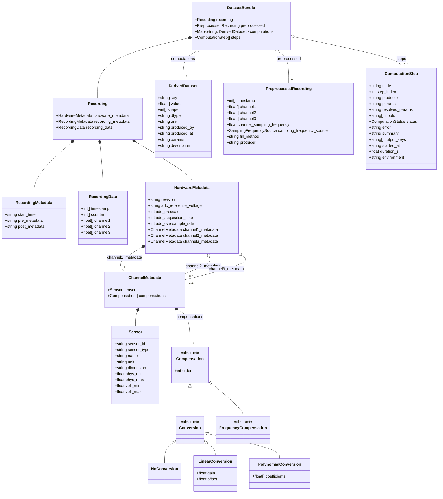

# ICOschema

Backend-agnostic data model for sensor/hardware recordings and their derived computations.

## Install

```sh
uv venv --allow-existing
uv sync --all-extras
```

## Usage

**Note:** In the example below we assume you installed Matplotlib:

```sh
uv pip install matplotlib
```

Other codebases should only import `Recording`/`DatasetBundle` from the top-level package:

```python
from icoschema import Recording, DatasetBundle

import matplotlib.pyplot as plt

recording = Recording.from_hdf5("test/test_with_sensors.hdf5")
df = recording.to_dataframe()
plt.plot(recording.timestamps, recording.channel1)
plt.show()
recording.to_hdf5("some_file.hdf5")

bundle = DatasetBundle.from_hdf5("some_file.hdf5")  # recording + any DerivedDataset computations
# Note: The code below does not work, since `derived` is not defined
#       Adding the code for `derived` from the example below will not work,
#       since then `my_wavelet_transform` is not defined.
bundle = bundle.with_computation("wavelet_coefficients/channel1/details", derived)
bundle.to_hdf5("some_file.hdf5")
```

### Example use cases

**Inspect a recording without loading a full DataFrame:**

```python
recording = Recording.from_hdf5("some_file.hdf5")
print(recording.signal_loss_percentage)
print(recording.summary())                # JSON-encodable dict: per-channel min/max/mean/std, sensor info
```

**Add a derived computation and persist it alongside the recording:**

```python
from icoschema.schema.generated.python.dataset import DerivedDataset

bundle = DatasetBundle.from_hdf5("some_file.hdf5")
coeffs = my_wavelet_transform(bundle.recording.channel1)
derived = DerivedDataset(
    key="wavelet_coefficients/channel1/details",
    values=coeffs.flatten().tolist(),
    shape=list(coeffs.shape),
    dtype=str(coeffs.dtype),
    produced_by="wavelet_transform@1.0.0",
)
bundle = bundle.with_computation(derived.key, derived)
bundle.to_hdf5("processed_file.hdf5")
```

**Place samples on the gap-free grid and get the sampling frequency:**

```python
recording = Recording.from_hdf5("some_file.hdf5")
recording.sample_index()                 # grid position of every received row (lost packets leave holes)
recording.filled_mask()                  # True where a packet was lost, over the whole grid
recording.channel_sampling_frequency()   # (Hz per channel, "hardware" | "default")
```

The total sampling frequency is the ADC rate, shared by all channels:
`38.4 MHz / ((adc_prescaler + 1) * (adc_acquisition_time + 13) * adc_oversample_rate)`,
from the `adc_*` settings recorded in the file, or from the default settings (2, 8, 64 → 9523.81 Hz) when the file
doesn't record them. The per-channel frequency is that divided by the number of channels.

**Store a preprocessed table (lost packets filled, timestamps on the 1 / f_s grid):**

```python
from icoschema import PreprocessedRecording

bundle = DatasetBundle.from_hdf5("some_file.hdf5")
preprocessed = PreprocessedRecording(
    timestamp=...,                     # first raw timestamp + round(j * 1e6 / channel_sampling_frequency)
    channel1=...,                      # raw channel1 on the grid, not converted
    channel_sampling_frequency=fs,     # Hz per channel
    sampling_frequency_source="default",
    fill_method="forward_fill",
    producer="my_tool@1.0",
)
bundle = bundle.with_preprocessed(preprocessed)   # raises if it doesn't fit the recording
bundle.to_hdf5("some_file.hdf5")
```

The preprocessed channels mean exactly what the raw channels mean (same sensors and compensations). The raw recording
stays untouched; while a bundle has a preprocessed table, `with_recording` raises — call `without_preprocessed()`
first.

**Record the steps that produced the computations:**

```python
from icoschema import ComputationStep

bundle = bundle.with_computation("rms/channel1", derived)          # add the step's data first
bundle = bundle.with_step(ComputationStep(
    node="rms",                        # unique, one HDF5 path segment
    step_index=0,                      # assigned by with_step
    producer="rms@1.0.0",
    params='{"window_size": 200}',
    output_keys=["rms/channel1"],      # authoritative link from the step to its data
    status="ok",
))
bundle.computations_of("rms")          # {"rms/channel1": ...}
bundle.unmanaged_keys()                # computations no step lists
bundle = bundle.without_steps(["rms"]) # drops the step and its output_keys; the rest is renumbered
```

`steps` is a list ordered by `step_index`. `with_step` raises for a duplicate or malformed node name, or an
`output_keys` entry that isn't in `computations`. How steps are named or how keys relate to node names is up to the
producer.

### File format

- `1.0`: the recording (primary table + `sensors`) and optional `/computations/`.
- `1.1`: additionally a preprocessed table. Written only when the bundle has one, so files without it stay readable
  by older versions, which reject `1.1` instead of silently dropping the table.
- `1.2`: additionally a `/steps/` group (one attribute-only group per step). Written only when the bundle has steps;
  read back ordered by `step_index`. A malformed step, or one whose `output_keys` are missing, is skipped (or raises
  with `on_error="raise"`).
- Legacy files (no version, table `acceleration`) are read as before.
- All datasets with more than one element are gzip-compressed. The `pre_metadata`/`post_metadata` attributes of the
  primary table are preserved.

## Development

Regenerate the Python dataclasses after editing the schema:

```
uv run gen-python icoschema/schema/linkml/dataset.yaml > icoschema/schema/generated/python/dataset.py
```

Run the tests:

```
uv run pytest
```

## Schema



## Open questions

- All channels in a `RecordingData` share one `timestamp`/`counter` array set, i.e. one sample rate per recording. Mixing sensors with different data rates on different channels isn't representable yet — would likely need a per-channel rate/timestamp instead of one shared pair.

## Development

In the text below we assume that you installed:

- [`just`](https://just.systems)
- [`uv`](https://docs.astral.sh/uv)

and that you want to release version `<VERSION>` of the package. Please just replace this version number with the version that you want to release (e.g. `0.1.0`).

### Release

1. Change the version number and commit your changes:

   ```sh
   just release <VERSION>
   ```

   **Note:** [GitHub Actions](https://github.com/ift-tuwien/ICOschema/actions) will publish a package based on the tagged commit and upload it to [PyPi](https://pypi.org/project/icoschema/).

2. Create a new release [here](https://github.com/ift-tuwien/ICOschema/releases/new)
   1. Insert the version number `<VERSION>` into the tag field
   2. For the release title use “Version `<VERSION>`”
   3. Paste the [release notes](doc/releases) for the lastest release into the main text field
   4. Click on “Publish Release”

   **Note:** Alternatively you can also use the [`gh`](https://cli.github.com) command:

   ```sh
   gh release create <VERSION>
   ```

   to create the release notes.
