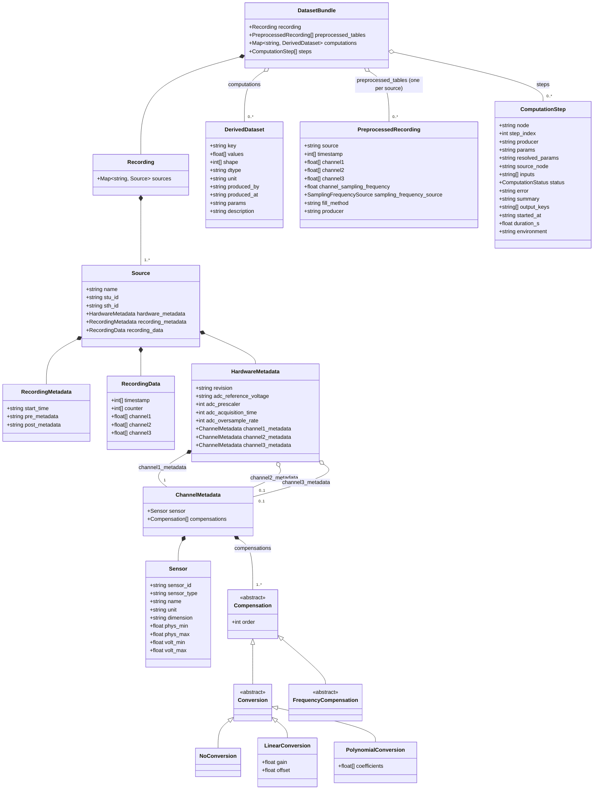

# ICOschema

Backend-agnostic data model for sensor/hardware recordings and their derived computations.

## Install

```sh
uv venv --allow-existing
uv sync
```

## Usage

**Note:** In the example below we assume you installed Matplotlib:

```sh
uv pip install matplotlib
```

Other codebases should only import `Recording`/`DatasetBundle` from the top-level package:

```python
from icoschema import Recording, DatasetBundle

import matplotlib.pyplot as plt

recording = Recording.from_hdf5("test/v1/test_with_sensors.hdf5")
df = recording.to_dataframe()
plt.plot(recording.timestamps, recording.channel1)
plt.show()
recording.to_hdf5("some_file.hdf5")

bundle = DatasetBundle.from_hdf5("some_file.hdf5")  # recording + any DerivedDataset computations
# Note: The code below does not work, since `derived` is not defined
#       Adding the code for `derived` from the example below will not work,
#       since then `my_wavelet_transform` is not defined.
bundle = bundle.with_computation("wavelet_coefficients/channel1/details", derived)
bundle.to_hdf5("some_file.hdf5")
```

### Schema and file format versions

`from icoschema import ...` gives the latest schema version. To stay on one, import from its namespace; it has the
whole API (`Recording`, `Source`, `DatasetBundle`, `Sensor`, ... all as typed dataclasses):

```python
from icoschema import v1

bundle = v1.DatasetBundle.from_hdf5("some_file.hdf5")
bundle.to_hdf5("out.hdf5")                          # the oldest file format version that can hold the bundle
bundle.to_hdf5("out.hdf5", format_version="1.2")    # a chosen one; ValueError if it can't hold the bundle
v1.hdf5_format_versions(writable=True)              # ("1.0", "1.1", "1.2", "1.3", "1.4")
```

The schema version decides which classes you work with; the file format version is only how they are stored.

### Schema version 2 (`icoschema.v2`)

Compared to version 1:

- `Sensor` has no `phys_min`, `phys_max`, `volt_min` and `volt_max` any more.
- Every `ChannelMetadata` has a `conversion` next to its `sensor` (required), replacing the list `compensations`.
  A conversion says what *was applied* to the raw (voltage) values to get the stored ones: the stored values are
  the values after it, and it is never to be applied again. Only two kinds remain: `NoConversion` (nothing was
  applied: the values are raw voltage values) and `LinearConversion` (`stored = raw * gain + offset`, in the
  sensor's unit). `Compensation`,
  `FrequencyCompensation` and `PolynomialConversion` are gone. A conversion carries a `conversion_type` (its class
  name), which keeps a parameterless `NoConversion` from being an empty value.
- `Source.stu_id` and `Source.sth_id` are `stu_mac` and `sth_mac`; a source has a new optional `description`.
- Its HDF5 files are format `2.0` (one layout that holds everything the `1.x` formats did) (with the `/pictures/` and `/files/` groups, see below): the `sensors` table has
  the columns `dimension`, `name`, `sensor_id`, `sensor_type`, `unit` and the channel's conversion (`conversion`
  "none" or "linear", `gain`, `offset`); there is no table-wide `conversion` attribute; a source's `description`,
  `stu_mac` and `sth_mac` are attributes of its primary table. Files of version 1 (`1.x` or unversioned) are read
  with `icoschema.v1`; reading one with `icoschema.v2` raises an error that says so.
- A TDMS file is still read in its one (unversioned) layout. Its values are in the unit of the channel already, so
  each channel gets an identity `LinearConversion` (a conversion that changed nothing, not `NoConversion`), and `stu_mac` stays unset (a group name is
  not a MAC address).

`from icoschema import ...` means version 2 (the latest); `from icoschema import v1` stays on version 1, which is
the one that reads version 1 files. `icoschema.migrate` converts version 1 data to version 2:
`migrate.convert_file("old.hdf5", "new.hdf5")` or `migrate.v1_to_v2(bundle)`. A file of version 1 is taken as
converted already, whatever its `conversion` attribute says (the data acquisition always wrote its values in the
unit of the sensor), so no value is changed and every channel becomes a `LinearConversion` that records what was
done: gain and offset are the channel's
`scaling_factor`/`offset` of the file's `sensors` table, else those of a v1 `LinearConversion`, else derived from the
sensor's range (`gain = Δphys / Δvolt`, `offset = phys_min - gain * volt_min`), else 1 and 0.

#### Recording while it is measured: `BundleWriter`

A `DatasetBundle` holds every sample as a Python object, which is far too much memory for a long recording. A
`BundleWriter` appends the samples to the file as they arrive and writes the file a `DatasetBundle` would
(format 2.0), so every reader reads it:

```python
from icoschema.v2 import BundleWriter, SourceSpec, ChannelMetadata, LinearConversion, Sensor

channel = ChannelMetadata(
    sensor=Sensor(sensor_id="acc100g", name="Acceleration", unit="g", dimension="Acceleration"),
    conversion=LinearConversion(gain=0.0123, offset=-6.5),  # applied to the raw volts: the values are in "g"
)
spec = SourceSpec(
    name="sth1",                                            # a source is one STU/STH combination
    channels=[channel],
    start_time="2026-11-14T10:00:00.000000",                # of this source; sources have their own clocks
    stu_mac="08-6B-D7-0F-47-2C",
    sth_mac="14-2D-41-D7-77-7D",
    adc_prescaler=2, adc_acquisition_time=8, adc_oversample_rate=64, adc_reference_voltage=3.3,
)
with BundleWriter("measurement.hdf5", [spec]) as writer:    # several specs: several sources, one file
    source = writer["sth1"]
    source.append_row(timestamp=0, values=[2048.0], counter=0)  # microseconds since `start_time`
    source.append(timestamps, [channel1_values], counters)      # or many rows at once
    source.update(additional_data='{"dataloss": 0.0}')          # what is only known later
    writer.add_file("report", pdf_bytes, mime="application/pdf")
```

What is known before the first sample (sensors, conversions, ADC settings, start time, MACs) is written when the
file is opened, so even a file whose writer was never closed says what its data is. Rows are buffered
(`chunk_rows`, default 8192) and written in compressed chunks; `flush()` writes them out at any time. A writer
is not thread-safe: use one from a single thread.

#### Pictures and embedded files

Both belong to the bundle as a whole and are stored in groups of their own: `/pictures/<name>` (a
set of images, each one the base64 text of an image) and `/files/<name>` (the bytes of a file, with its `mime`
type and `original_name`):

```python
bundle = bundle.with_picture("post__pictures", [image_base64, ...])
bundle = bundle.with_file("report", pdf_bytes, mime="application/pdf", original_name="Report 1.pdf")
bundle.pictures, bundle.files            # name -> list of images, name -> EmbeddedFile
bundle.to_hdf5("some_file.hdf5")
```

To add one to a file that is already on disk without loading it (a measurement can be large), use
`icoschema.v2.attachments` (`add_picture`, `add_file`, `list_files`, `read_file`, `read_pictures`,
`remove_file`); it changes the file in place.

Files written by the data acquisition before these groups existed keep the picture sets as arrays at the root of
the file (a name with "picture" in it) and the embedded files under `/embedded_files/`. Reading finds them there,
whatever the schema version of the file, so saving (or `icoschema.migrate.convert_file`) moves them into the
groups.

#### Nothing is dropped

Everything in a file that this package has no model for is kept and written back where it was: unknown
attributes (of the root, a primary table, computations, steps, ...), unknown nodes (groups, datasets and links,
anywhere), malformed computations and steps, and a `sensors` table with columns version 2 has no place for (kept
as `sensors__original` next to the new one). They are in `bundle.preserved`, opaque to this package. Left out
are only PyTables bookkeeping (`CLASS`, `TITLE`, ...) of the nodes this package models, and what a migration turns
into something else (the v1 `conversion` flag and range columns become the channel's `LinearConversion`). Limits:
preserved datasets are held in memory, HDF5 references can't be copied between files (this is logged), and a
dataset is written back with the package's usual compression, not the chunking it had.

To open a file of any schema version in an application, use `icoschema.read(path)`: it returns the latest
`DatasetBundle`, migrating an older file as above. `icoschema.schema_version_of_file(path)` tells the version of a
file without reading it. (A TDMS file has no format version, so it always counts as version 1.)

### TDMS files (read-only)

`DatasetBundle.from_tdms(path)` / `Recording.from_tdms(path)` read an NI TDMS file, and
`DatasetBundle.from_file(path)` takes either format, told apart by the file's first bytes. Like HDF5, reading dispatches
on a format version, here the root property `icoschema_format_version`; a file without one is read with the *legacy*
layout (`rawdata` group, `signalQuality` channels, one source per STU group), documented in
`icoschema/v1/storage/tdms.py`. A TDMS waveform has no packet counter, so a TDMS source has none: its
`sampling_frequency` is `1 / wf_increment`, its `timestamp`s are built from it, its `quality` is the file's
`signalQuality` channel (own rate; `Source.signal_loss_percentage` is `100 - mean(quality)`), each channel's `Sensor`
has the TDMS channel name and `unit_string`, and `additional_data` (opaque JSON) keeps the file's, group's and
channels' properties. Channels of a source must have equal length. `DatasetBundle.provenance` says where the data was
read from (`source_format`, `source_format_version`, `reader`, and `writer` for an HDF5 file). Sources have independent
clocks; `Recording.start_offsets()` and `Recording.time_axis(source)` place them against each other by their start
times without touching their own timestamps. There is no TDMS writer: save results with `to_hdf5` (format `1.4`).

### Sources (STU/STH combinations)

A `Recording` holds one or more independent `Source`s, one per STU/STH combination, each with its own clock
(`start_time`), packet counter, ADC settings (so its own sampling frequency) and sensors. Start times of different
sources are not synchronized. For a single-source recording (everything read from today's files) the usual
shortcuts keep working; with several sources they raise a `ValueError` and you pick a source:

```python
recording.channel1                          # single source only
source = recording.sources["source1"]       # files without a stored name read as "source1"
source.channel1, source.channel_sampling_frequency(), source.signal_loss_percentage
recording.to_dataframe(source="source1")
```

### Example use cases

**Inspect a recording without loading a full DataFrame:**

```python
recording = Recording.from_hdf5("some_file.hdf5")
print(recording.signal_loss_percentage)
print(recording.summary())                # JSON-encodable dict: per-channel min/max/mean/std, sensor info
```

**Add a derived computation and persist it alongside the recording:**

```python
from icoschema import DerivedDataset

bundle = DatasetBundle.from_hdf5("some_file.hdf5")
coeffs = my_wavelet_transform(bundle.recording.channel1)
derived = DerivedDataset(
    key="wavelet_coefficients/channel1/details",
    values=coeffs.flatten().tolist(),
    shape=list(coeffs.shape),
    dtype=str(coeffs.dtype),
    produced_by="wavelet_transform@1.0.0",
)
bundle = bundle.with_computation(derived.key, derived)
bundle.to_hdf5("processed_file.hdf5")
```

**Place samples on the gap-free grid and get the sampling frequency:**

```python
recording = Recording.from_hdf5("some_file.hdf5")
recording.sample_index()                 # grid position of every received row (lost packets leave holes)
recording.filled_mask()                  # True where a packet was lost, over the whole grid
recording.channel_sampling_frequency()   # (Hz per channel, "hardware" | "default")
```

The total sampling frequency is the ADC rate, shared by all channels:
`38.4 MHz / ((adc_prescaler + 1) * (adc_acquisition_time + 13) * adc_oversample_rate)`,
from the `adc_*` settings recorded in the file, or from the default settings (2, 8, 64 → 9523.81 Hz) when the file
doesn't record them. The per-channel frequency is that divided by the number of channels.

**Store a preprocessed table (lost packets filled, timestamps on the 1 / f_s grid):**

```python
from icoschema import PreprocessedRecording

bundle = DatasetBundle.from_hdf5("some_file.hdf5")
preprocessed = PreprocessedRecording(
    timestamp=...,                     # first raw timestamp + round(j * 1e6 / channel_sampling_frequency)
    channel1=...,                      # raw channel1 on the grid, not converted
    channel_sampling_frequency=fs,     # Hz per channel
    sampling_frequency_source="default",
    fill_method="forward_fill",
    producer="my_tool@1.0",
)
bundle = bundle.with_preprocessed(preprocessed)   # raises if it doesn't fit the recording
bundle.to_hdf5("some_file.hdf5")
```

The preprocessed channels mean exactly what the raw channels mean (same sensors and compensations). The raw recording
stays untouched; while a bundle has a preprocessed table, `with_recording` raises — call `without_preprocessed()`
first.

With several sources, a bundle holds one preprocessed table per source (each with its own grid and
`channel_sampling_frequency`), and `bundle.preprocessed` — the shortcut for a single source — raises:

```python
bundle = bundle.with_preprocessed(preprocessed, source="source2")   # or set `PreprocessedRecording.source`
bundle.preprocessed_for("source2")                                  # None if that source has none
bundle = bundle.without_preprocessed("source2")                     # no argument: drop all
```

A step says where it read from with one name, `ComputationStep.source_node`, from a single namespace:

| `source_node` | reads |
|---|---|
| `"source2"` | the raw recording of that source |
| `"preprocessed:source2"` | the preprocessed table of that source (`"preprocessed"` if there is only one source) |
| `"rms_source2"` | the computations of the earlier step with that `node` |
| `None` | the raw recording of a single-source file |

A step reading several things lists them in `inputs`. There is no separate "source" on steps or computations: a step's
source follows from what it reads. `bundle.source_of(name)` traces any of the names above back to its source (`None`
for a step over several sources), and `bundle.computations_for_source("source2")` selects what descends from one source.
Step names must not collide with source names or the reserved `preprocessed` names; whether a `source_node` names a
recorded step is not checked (it may have failed unrecorded). With several sources, run one step per source (e.g.
`rms_source1`, `rms_source2`) so that computation keys stay unique.

**Record the steps that produced the computations:**

```python
from icoschema import ComputationStep

bundle = bundle.with_computation("rms/channel1", derived)          # add the step's data first
bundle = bundle.with_step(ComputationStep(
    node="rms",                        # unique, one HDF5 path segment
    step_index=0,                      # assigned by with_step
    producer="rms@1.0.0",
    params='{"window_size": 200}',
    output_keys=["rms/channel1"],      # authoritative link from the step to its data
    status="ok",
))
bundle.computations_of("rms")          # {"rms/channel1": ...}
bundle.unmanaged_keys()                # computations no step lists
bundle = bundle.without_steps(["rms"]) # drops the step and its output_keys; the rest is renumbered
```

`steps` is a list ordered by `step_index`. `with_step` raises for a duplicate or malformed node name, or an
`output_keys` entry that isn't in `computations`. How steps are named or how keys relate to node names is up to the
producer.

### File format

- `1.0`: the recording (primary table + `sensors`) and optional `/computations/`.
- `1.1`: additionally a preprocessed table. Written only when the bundle has one, so files without it stay readable
  by older versions, which reject `1.1` instead of silently dropping the table.
- `1.2`: additionally a `/steps/` group (one attribute-only group per step). Written only when the bundle has steps;
  read back ordered by `step_index`. A malformed step, or one whose `output_keys` are missing, is skipped (or raises
  with `on_error="raise"`).
- `1.3`: several sources (one per STU/STH combination). The root attribute `sources` lists their names in order, and
  `/sources/<name>/` holds each source's table and `sensors` table the way a `1.0` file holds them at the root. May also
  have `/steps/` and `/computations/`. Written only when the recording has more than one source: a single source keeps
  the `1.0`-`1.2` layout (its name and STU/STH ids are stored as optional table attributes), so those files stay
  readable by older versions. A preprocessed table, if a source has one, is stored in that source's group.
- `1.4`: for sources that are not packet recordings (TDMS): the primary table may have no `counter` column and the
  table attributes `sampling_frequency` and `additional_data`; a `quality` dataset (attribute `sampling_frequency`) sits
  next to the table; a single source's name is always stored. Either layout (`sources` attribute or not) as in `1.0`-`1.3`.
  Written only when a source needs it. Every file also gets the root attribute `writer`, and `source_format`,
  `source_format_version`, `reader` when the bundle has a provenance (older readers ignore them).
- Legacy files (no version, table `acceleration`) are read as before.
- A file with an empty or missing `sensors` table (old recordings) is read with an unspecified `Sensor()` (every field
  `None`) per channel and no conversion, as long as its `conversion` attribute is `true`; if it isn't, there is no
  scaling to take from the sensor rows and reading raises. Such a recording is written back without a `sensors` table.
  Any other mismatch between channel columns and sensor rows still raises.
- The first acquisition tools' files (table `acceleration` of physical values in g, only `Start_Time` and
  `Sensor_Range` such as `± 100.0 g₀` as metadata) are read too: no `conversion` attribute (without sensor rows) means
  converted, a missing `adc_reference_voltage` is `None`, and `Sensor_Range` becomes each channel's sensor unit and
  range (`g`, -100..100). A `conversion`-less file that does have sensor rows raises.
- All datasets with more than one element are gzip-compressed. The `pre_metadata`/`post_metadata` attributes of the
  primary table are preserved.

## Development

Regenerate the Python dataclasses **and** the Rust types after editing the schema:

```
just generate
```

(`just check-generated` fails if the committed generated code is stale; CI runs it.) Run the tests:

```
just test        # Python
just test-rust   # Rust, see below
```

### Rust port

`rust/` is a Rust port of the model and storage layers, laid out like the Python package. Every schema version is a module of its own, self-contained like the Python
package of the same name (`icoschema::v1` is `icoschema.v1`, `icoschema::v2` is `icoschema.v2`), and the names at the
top level (`icoschema::DatasetBundle`, ...) are those of the latest one, version 2:

| | Python | Rust |
|---|---|---|
| generated schema | `icoschema/vN/schema/generated/dataset.py` | `icoschema/vN/schema/generated/rust` (crate `icoschema-gen-vN`) |
| model (convenience API) | `icoschema/vN/model` | `rust/src/vN/model` |
| storage (HDF5, TDMS) | `icoschema/vN/storage` | `rust/src/vN/storage` |
| migration, reading any version | `icoschema/migrate.py`, `icoschema/_read.py` | `rust/src/migrate.rs` |

Opening a file of any schema version as the latest one: `icoschema::read(path)` (a version 1 file is migrated by
`icoschema::migrate`, with the same rules as the Python package: see "Schema version 2" above;
`migrate::convert_file(old, new)` writes the result as a version 2 file), and `icoschema::schema_version_of_file(path)`
tells the version of a file without reading its data.

The rest of the Python API that has a Rust counterpart: `hdf5_format_versions(writable)` (per version module, and at the
top level for the latest), `to_hdf5_with(path, Some("1.2"))` to write a chosen format version (an error if the data does
not fit it; `to_hdf5(path)` picks the oldest that fits), `from_hdf5_with(path, OnError::Raise)` to fail on a malformed
computation or step instead of skipping it with a warning (the default, as in Python; `from_hdf5_with_warnings` returns
the warnings), and `Source::start_datetime()` / `Recording::earliest_start_datetime()` returning a `DateTime` (naive,
microseconds, ordered, `Display` as ISO 8601, `components()`, `seconds_since`, `plus_seconds`). There is no
`to_dataframe`: use `channel(n)` and the column getters.

```rust
let bundle = icoschema::DatasetBundle::from_hdf5("some_file.hdf5")?;
let source = bundle.recording.only_source()?;   // a recording has one or more sources
println!("{:.3} % lost", source.signal_loss_percentage());
let grid = source.sample_index()?;
let offsets = bundle.recording.start_offsets()?; // sources placed by their start times
```

Schema version 1 (`icoschema::v1`) reads all file format versions (legacy, 1.0 to 1.4) and writes 1.0 to 1.4 (several
sources, sources without a packet counter, `quality`, `additional_data`, provenance) like the Python package; schema
version 2 (`icoschema::v2`) reads and writes format 2.0, whose `sensors` table holds a conversion per channel (and
refuses version 1 files with a message pointing to `icoschema::v1`). In both, and `DatasetBundle::from_file`
tells HDF5 from TDMS by content. It reads TDMS files too (`DatasetBundle::from_tdms`, the legacy layout, with the
[`tedium`](https://crates.io/crates/tedium) crate, behind the `tdms` feature, on by default). Where it differs
from Python: NI scaling supports the `Linear` and `Polynomial` scale types (another type is an error, as in
`tdmspy`), a quality channel that is declared
with a type but holds no values is an error (a `tedium` limitation: the acquisition software's void-typed empty
channels work), and TDMS files that use DAQmx raw data are refused. Groups and channels keep their file order, which
`tedium` does not, so the reader scans the segment headers for it.
Storage uses [`rust-hdf5`](https://crates.io/crates/rust-hdf5), a pure Rust HDF5 library, so it builds without libhdf5 or any other C
code. The one thing `rust-hdf5` cannot do is read arrays of variable-length strings (`inputs`, `output_keys` of a step);
`rust/src/vN/storage/vlen.rs` does that itself.

```rust
let bundle = icoschema::DatasetBundle::from_hdf5("in.hdf5")?
    .with_computation("rms/channel1", derived)
    .with_step(step)?;               // numbered, validated like the Python `with_step`
bundle.to_hdf5("out.hdf5")?;         // gzip + shuffle, lowest sufficient format version
```

The writer produces what the Python writer produces (the tests compare what Python reads back), with two differences,
both on purpose: where Python quietly loses information the Rust writer returns an error. That covers (in version 1) compensations
the file format has no place for (`PolynomialConversion`, `FrequencyCompensation`, more than one per channel), the hardware `revision`, values
that do not fit their column (counter above 255, negative timestamps, a sensor text longer than its field) and
computation dtypes it cannot store. And a failed write never leaves a file: it writes to `<file>.tmp` and renames it.
Files use HDF5 superblock version 2, which every HDF5 library since 1.8 reads.

**Changing the schema.** Edit `icoschema/vN/schema/dataset.yaml`, run `just generate`, then `just test-rust`. (`gen-rust`
cannot handle `designates_type`, so `scripts/generate.py` generates the Rust crate from a copy of the schema without
that line; the Rust code does not use the designator.) The Rust side cannot silently fall behind:

- a new or renamed *attribute* makes `rust/src/storage` fail to compile (every generated struct is built field by
  field), pointing at the code to extend;
- a new *enum value* fails to compile too (the enum name tables match exhaustively);
- a new *class* or *subclass* can compile fine, so `rust/tests/schema_coverage.rs` (`schema_coverage_v2.rs`) compares the schema with the
  manifest in `rust/src/vN/schema_support.rs` and fails naming the new element. Handle it, then list it there (as handled,
  or as unsupported with the reason, for things the file format has no place for such as `PolynomialConversion`).

The Rust tests of schema version 2 read the stored synthetic files of the Python package (`test/v2/data`, `rust/tests/v2.rs`)
and the migration is tested on those of version 1 (`test/v1/data`, `rust/tests/migrate.rs`). The tests of version 1 read fixtures in
`rust/tests/fixtures` and compare every value with what the Python implementation reads
from the same files (`expected.json`, `reference.rs`), and what it reads after writing them again (`expected_roundtrip.json`,
`writer.rs`). `rust/tests/interop.py` (part of `just test-rust`) goes the other way: Rust writes every fixture and the
Python package, on libhdf5 through h5py, must read the same content; the same for the version 2 files, and Rust's migration of
every version 1 file must read as Python's. After changing the Python reader or writer, rebuild
the fixtures with `just rust-fixtures`.

## Schema



## Open questions

- All channels of one `Source` share one `timestamp`/`counter` array set, i.e. one sample rate per source. Mixing sensors with different data rates on different channels of the same STU/STH combination isn't representable — would likely need a per-channel rate/timestamp. Different *sources* may have different rates.

## Development

In the text below we assume that you installed:

- [`just`](https://just.systems)
- [`uv`](https://docs.astral.sh/uv)

and that you want to release version `<VERSION>` of the package. Please just replace this version number with the version that you want to release (e.g. `0.1.0`).

### Release

1. Change the version number and commit your changes:

   ```sh
   just release <VERSION>
   ```

   **Note:** [GitHub Actions](https://github.com/ift-tuwien/ICOschema/actions) will publish a package based on the tagged commit and upload it to [PyPi](https://pypi.org/project/icoschema/).

2. Create a new release [here](https://github.com/ift-tuwien/ICOschema/releases/new)
   1. Insert the version number `<VERSION>` into the tag field
   2. For the release title use “Version `<VERSION>`”
   3. Paste the [release notes](doc/releases) for the lastest release into the main text field
   4. Click on “Publish Release”

   **Note:** Alternatively you can also use the [`gh`](https://cli.github.com) command:

   ```sh
   gh release create <VERSION>
   ```

   to create the release notes.
